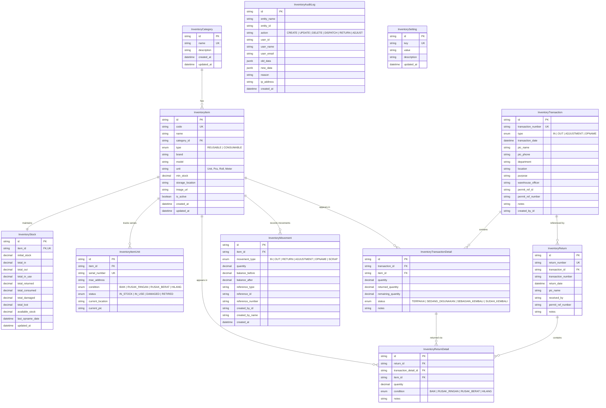

# INVENTORY MANAGEMENT SYSTEM - DATABASE SPECIFICATION
**Application:** ACTIS (Activation, Configuration, & Termination ISP System)  
**Database Engine:** PostgreSQL 14+ / 16+ via Prisma ORM  
**Schema File:** `prisma/schema.prisma`  

---

## 1. Entity-Relationship Diagram (ERD)

---

## 2. Table Specifications

### 2.1 `inventory_categories`
Menampung pengelompokan jenis barang (misal: Router, Switch, Optical, Tools, Cable, Passive, Hardware).

| Field | Tipe Data | Constraint | Keterangan |
| :--- | :--- | :--- | :--- |
| `id` | `VARCHAR(36)` | PK, UUID | Pengenal unik kategori |
| `name` | `VARCHAR(100)` | UNIQUE, NOT NULL | Nama kategori |
| `description` | `TEXT` | NULLABLE | Deskripsi peruntukan kategori |
| `created_at` | `TIMESTAMPTZ` | DEFAULT `NOW()` | Waktu pembuatan |
| `updated_at` | `TIMESTAMPTZ` | DEFAULT `NOW()` | Waktu pembaruan terakhir |

---

### 2.2 `inventory_items`
Master katalog barang inventaris.

| Field | Tipe Data | Constraint | Keterangan |
| :--- | :--- | :--- | :--- |
| `id` | `VARCHAR(36)` | PK, UUID | Pengenal unik barang |
| `code` | `VARCHAR(50)` | UNIQUE, NOT NULL | Kode barang (misal: `ITM-ROU-0001`) |
| `name` | `VARCHAR(200)` | NOT NULL | Nama barang |
| `category_id` | `VARCHAR(36)` | FK $\rightarrow$ `inventory_categories.id` | Kategori barang |
| `type` | `VARCHAR(20)` | NOT NULL, CHECK in (`REUSABLE`, `CONSUMABLE`) | Tipe barang |
| `brand` | `VARCHAR(100)` | NULLABLE | Merek / Pabrikan (MikroTik, Ruijie, Cisco, Belden) |
| `model` | `VARCHAR(100)` | NULLABLE | Model / Tipe spesifik |
| `serial_number` | `VARCHAR(100)` | NULLABLE | Serial number umum (jika unit tunggal) |
| `unit` | `VARCHAR(20)` | DEFAULT `'Unit'` | Satuan fisik (Unit, Pcs, Roll, Meter, Pack) |
| `min_stock` | `DECIMAL(12,2)` | DEFAULT `5.00` | Ambang batas peringatan stok minimum |
| `storage_location` | `VARCHAR(150)` | DEFAULT `'Gudang Utama'` | Rak / Gudang penyimpanan |
| `description` | `TEXT` | NULLABLE | Catatan teknis & spesifikasi |
| `image_url` | `TEXT` | NULLABLE | Foto barang |
| `is_active` | `BOOLEAN` | DEFAULT `TRUE` | Status aktif (Soft-delete protection) |
| `created_at` | `TIMESTAMPTZ` | DEFAULT `NOW()` | Waktu registrasi barang |
| `updated_at` | `TIMESTAMPTZ` | DEFAULT `NOW()` | Waktu pembaruan terakhir |

---

### 2.3 `inventory_item_units`
Pencatatan individual serial number untuk barang reusable berharga tinggi.

| Field | Tipe Data | Constraint | Keterangan |
| :--- | :--- | :--- | :--- |
| `id` | `VARCHAR(36)` | PK, UUID | Pengenal unik unit |
| `item_id` | `VARCHAR(36)` | FK $\rightarrow$ `inventory_items.id` (CASCADE) | ID Master barang |
| `serial_number` | `VARCHAR(100)` | UNIQUE, NOT NULL | Nomor seri fisik unit |
| `mac_address` | `VARCHAR(50)` | NULLABLE | Alamat MAC (khusus perangkat jaringan) |
| `condition` | `VARCHAR(20)` | NOT NULL, DEFAULT `'BAIK'` | `BAIK`, `RUSAK_RINGAN`, `RUSAK_BERAT`, `HILANG` |
| `status` | `VARCHAR(20)` | NOT NULL, DEFAULT `'IN_STOCK'` | `IN_STOCK`, `IN_USE`, `DAMAGED`, `RETIRED` |
| `current_location` | `VARCHAR(150)` | NULLABLE | Lokasi fisik unit saat ini (POP/Gedung) |
| `current_pic` | `VARCHAR(100)` | NULLABLE | Nama person in charge pemegang unit |
| `notes` | `TEXT` | NULLABLE | Riwayat kondisi unit |

---

### 2.4 `inventory_stocks`
Tabel saldo kalkulasi stok aktual. Menggunakan tipe `DECIMAL(12,2)` untuk presisi matematis non-floating point.

| Field | Tipe Data | Constraint | Keterangan |
| :--- | :--- | :--- | :--- |
| `id` | `VARCHAR(36)` | PK, UUID | Pengenal record stok |
| `item_id` | `VARCHAR(36)` | UNIQUE, FK $\rightarrow$ `inventory_items.id` | ID Master barang (1-to-1) |
| `initial_stock` | `DECIMAL(12,2)` | DEFAULT `0.00` | Saldo stok awal sistem |
| `total_in` | `DECIMAL(12,2)` | DEFAULT `0.00` | Total kumulatif barang masuk |
| `total_out` | `DECIMAL(12,2)` | DEFAULT `0.00` | Total kumulatif barang keluar |
| `total_in_use` | `DECIMAL(12,2)` | DEFAULT `0.00` | Kuantitas reusable yang sedang digunakan di lapangan |
| `total_returned` | `DECIMAL(12,2)` | DEFAULT `0.00` | Kuantitas reusable yang telah dikembalikan |
| `total_consumed` | `DECIMAL(12,2)` | DEFAULT `0.00` | Kuantitas consumable yang telah dikonsumsi permanen |
| `total_damaged` | `DECIMAL(12,2)` | DEFAULT `0.00` | Kuantitas barang rusak (tidak siap pakai) |
| `total_lost` | `DECIMAL(12,2)` | DEFAULT `0.00` | Kuantitas barang hilang |
| `available_stock` | `DECIMAL(12,2)` | DEFAULT `0.00` | Stok bersih siap digunakan di gudang |
| `last_opname_date` | `TIMESTAMPTZ` | NULLABLE | Tanggal pelaksanaan opname fisik terakhir |
| `updated_at` | `TIMESTAMPTZ` | DEFAULT `NOW()` | Waktu transaksi stok terakhir |

---

### 2.5 `inventory_transactions`
Header transaksi gudang (Barang Masuk, Barang Keluar, Adjustment, Opname).

| Field | Tipe Data | Constraint | Keterangan |
| :--- | :--- | :--- | :--- |
| `id` | `VARCHAR(36)` | PK, UUID | ID transaksi |
| `transaction_number` | `VARCHAR(50)` | UNIQUE, NOT NULL | Nomor dokumen (`IN-20261113-0001`, `OUT-...`) |
| `type` | `VARCHAR(20)` | NOT NULL | `IN`, `OUT`, `ADJUSTMENT`, `OPNAME` |
| `transaction_date` | `TIMESTAMPTZ` | DEFAULT `NOW()` | Tanggal transaksi |
| `pic_name` | `VARCHAR(100)` | NOT NULL | Nama penerima / penanggung jawab |
| `pic_phone` | `VARCHAR(50)` | NULLABLE | Nomor kontak WhatsApp / telepon |
| `department` | `VARCHAR(100)` | DEFAULT `'Operasional / NOC'` | Tim / Departemen pemohon |
| `location` | `VARCHAR(200)` | NOT NULL | Lokasi penggunaan / asal barang |
| `purpose` | `VARCHAR(200)` | NOT NULL | Tujuan pengeluaran / pengadaan |
| `warehouse_officer`| `VARCHAR(100)` | NOT NULL | Petugas gudang yang memproses |
| `permit_ref_id` | `VARCHAR(100)` | NULLABLE | ID dokumen Permit Barang terkait |
| `permit_ref_number`| `VARCHAR(100)` | NULLABLE | Nomor surat resmi Permit Barang |
| `notes` | `TEXT` | NULLABLE | Catatan tambahan |
| `created_by_id` | `VARCHAR(36)` | NULLABLE | ID user pembuat |
| `created_by_name` | `VARCHAR(100)` | NULLABLE | Nama user pembuat |
| `created_at` | `TIMESTAMPTZ` | DEFAULT `NOW()` | Waktu simpan |

---

### 2.6 `inventory_transaction_details`
Detail item barang dalam transaksi keluar atau masuk.

| Field | Tipe Data | Constraint | Keterangan |
| :--- | :--- | :--- | :--- |
| `id` | `VARCHAR(36)` | PK, UUID | ID baris detail |
| `transaction_id` | `VARCHAR(36)` | FK $\rightarrow$ `inventory_transactions.id` | Header transaksi |
| `item_id` | `VARCHAR(36)` | FK $\rightarrow$ `inventory_items.id` | Barang yang ditransaksikan |
| `quantity` | `DECIMAL(12,2)` | NOT NULL | Kuantitas keluar / masuk |
| `returned_quantity`| `DECIMAL(12,2)` | DEFAULT `0.00` | Kuantitas yang telah dikembalikan |
| `remaining_quantity`| `DECIMAL(12,2)` | DEFAULT `0.00` | Sisa kuantitas di luar gudang |
| `status` | `VARCHAR(30)` | NOT NULL | `TERPAKAI`, `SEDANG_DIGUNAKAN`, `SEBAGIAN_KEMBALI`, `SUDAH_KEMBALI` |
| `notes` | `TEXT` | NULLABLE | Catatan detail & nomor seri unit |

---

### 2.7 `inventory_returns` & `inventory_return_details`
Header dan detail pengembalian barang reusable ke gudang.

- **Header (`inventory_returns`):**
  - `return_number` (Unique, format `RET-YYYYMMDD-XXXX`).
  - `transaction_id` (FK ke `inventory_transactions.id`).
  - `pic_name`, `received_by`, `return_date`, `notes`.
- **Detail (`inventory_return_details`):**
  - `transaction_detail_id` (FK ke `inventory_transaction_details.id`).
  - `item_id` (FK ke `inventory_items.id`).
  - `quantity` (`DECIMAL(12,2)`).
  - `condition` (`BAIK`, `RUSAK_RINGAN`, `RUSAK_BERAT`, `HILANG`).

---

### 2.8 `inventory_movements` (Append-Only Ledger)
Buku besar mutasi stok yang tidak dapat diubah maupun dihapus.

| Field | Tipe Data | Constraint | Keterangan |
| :--- | :--- | :--- | :--- |
| `id` | `VARCHAR(36)` | PK, UUID | ID pergerakan |
| `item_id` | `VARCHAR(36)` | FK $\rightarrow$ `inventory_items.id` | Barang yang bergerak |
| `movement_type` | `VARCHAR(20)` | NOT NULL | `IN`, `OUT`, `RETURN`, `ADJUSTMENT`, `OPNAME`, `SCRAP` |
| `quantity` | `DECIMAL(12,2)` | NOT NULL | Kuantitas pergerakan (+ atau -) |
| `balance_before` | `DECIMAL(12,2)` | NOT NULL | Saldo stok sebelum transaksi |
| `balance_after` | `DECIMAL(12,2)` | NOT NULL | Saldo stok sesudah transaksi |
| `reference_type` | `VARCHAR(50)` | NOT NULL | Tipe dokumen referensi |
| `reference_id` | `VARCHAR(36)` | NULLABLE | ID entitas dokumen |
| `reference_number` | `VARCHAR(50)` | NOT NULL | Nomor dokumen (`IN-...`, `OUT-...`, `RET-...`) |
| `created_by_id` | `VARCHAR(36)` | NULLABLE | ID user eksekutor |
| `created_by_name` | `VARCHAR(100)` | NULLABLE | Nama user eksekutor |
| `created_at` | `TIMESTAMPTZ` | DEFAULT `NOW()` | Timestamp transaksi |

---

### 2.9 `inventory_audit_logs` & `inventory_settings`
- **Audit Logs:** Menyimpan jejak rekam mutasi data non-stok (misal pembaruan PIC/lokasi pemakaian, perubahan spesifikasi master barang) lengkap dengan payload JSON sebelum dan sesudah perubahan.
- **Settings:** Konfigurasi parameter key-value bawaan gudang (`DEFAULT_WAREHOUSE_NAME`, `DEFAULT_MIN_STOCK`, `NOTIFY_ON_LOW_STOCK`, `ITEM_CODE_PREFIX`).

